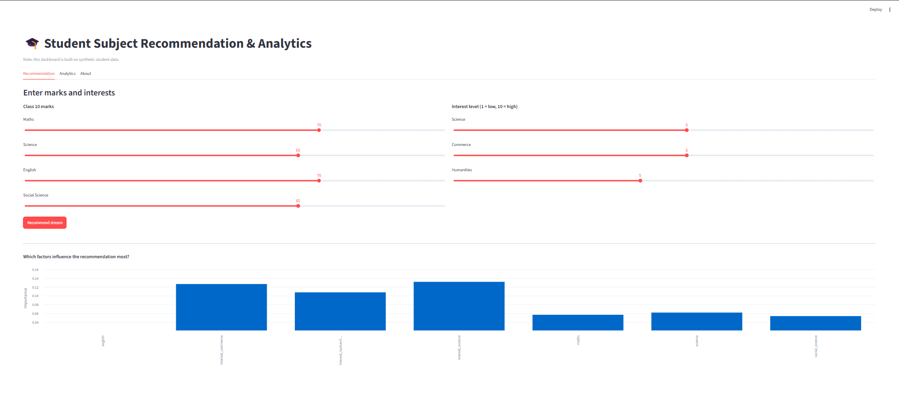
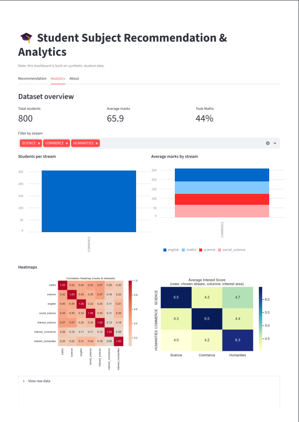

# Student Subject Recommendation & Analytics

An end-to-end data project that recommends a Class 11 stream (Science, Commerce or Humanities) from a student's Class 10 marks and interests, and presents the results in an interactive dashboard.

It extends an earlier school project (a menu-driven subject selection program built in Python and MySQL) into a full workflow covering data cleaning, SQL analysis, visualisation, machine learning and a web dashboard.

**Live demo:** [https://subject-recommendation-analytics.streamlit.app]
App may take about a minute to wake up if idle.

> **Note on data:** all data in this project is **synthetic**. It was generated with a Python script using fixed rules plus random noise. Model accuracy therefore reflects how well the model recovers those rules, not real-world performance.

## Dashboard




## Pipeline

| Step | Script | What it does |
|------|--------|--------------|
| 1 | `generate_data.py` | Generates 800 synthetic students with marks, interest scores and stream, plus injected missing values and duplicates |
| 2 | `clean_data.py` | Removes duplicates, imputes missing marks with stream-wise medians, validates ranges, standardises text |
| 3 | `sql_analysis.py` | Loads data into SQLite and runs 10 analytical queries (GROUP BY, HAVING, CASE, subquery, window function, JOIN) |
| 4 | `make_charts.py` | Produces bar charts, correlation heatmap, interest heatmap and boxplot |
| 5 | `train_model.py` | Compares Logistic Regression and Random Forest, saves the better model, reports permutation feature importance |
| 6 | `app.py` | Streamlit dashboard with recommendation, analytics and about tabs |

## Results (on synthetic data)

- Logistic Regression: 76.2% test accuracy (Random Forest: 73.8%) on a held-out 20% split
- Interest scores contributed more to predictions than marks in this dataset
- The dashboard returns a confidence score for each stream, for example Commerce 78%, Science 17%, Humanities 5%

## Tech stack

Python, pandas, NumPy, SQLite (SQL), matplotlib, seaborn, scikit-learn, Streamlit

## Run locally

```bash
git clone <your-repo-url>
cd subject-recommendation-analytics
pip install -r requirements.txt

python generate_data.py
python clean_data.py
python sql_analysis.py
python make_charts.py
python train_model.py
streamlit run app.py
```

## Project structure

```
├── generate_data.py
├── clean_data.py
├── sql_analysis.py
├── make_charts.py
├── train_model.py
├── app.py
├── requirements.txt
├── students.db              # SQLite database (generated)
├── stream_model.joblib      # trained model (generated)
├── feature_importance.csv   # model explainability output (generated)
├── charts/                  # generated charts
└── screenshots/             # dashboard screenshots
```

## Limitations

- Synthetic data: findings are illustrative and should not be used for real advice
- The recommendation model uses only marks and interest scores
- Streams are assigned by a rule-based generator, not by real student decisions

## Author

Priyanshu Mamgain
